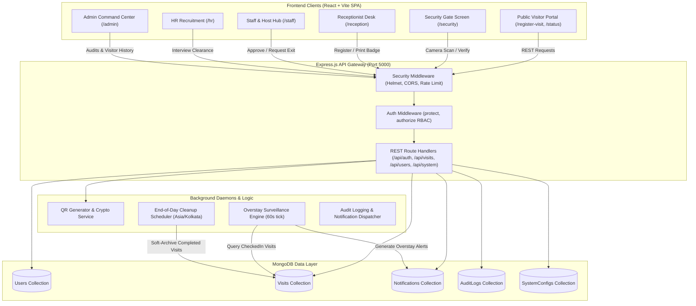
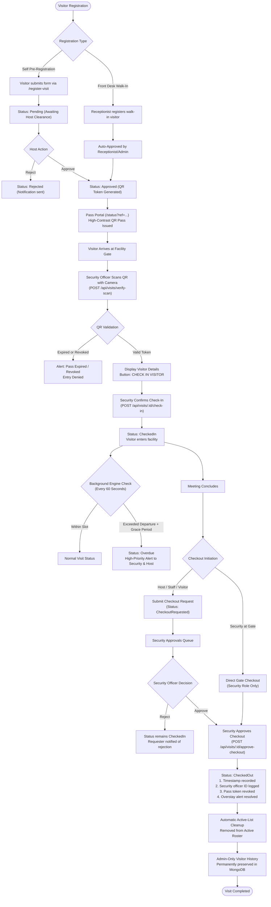
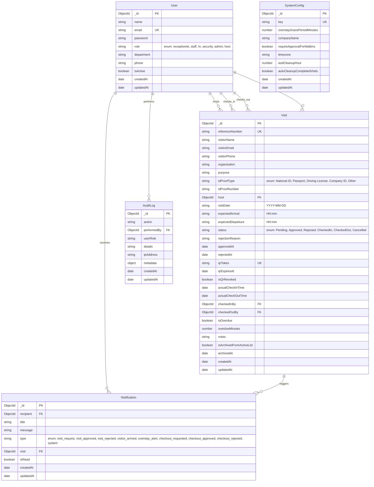

# Vistara — Enterprise Visitor Management System

[](https://react.dev)
[](https://nodejs.org)
[](https://www.mongodb.com)
[](https://vitejs.dev)
[](LICENSE)

> A production-grade, secure, and intuitive Enterprise Visitor Management System built with the pure MERN stack. Designed specifically for corporate headquarters, commercial office facilities, and enterprise multi-tenant buildings.

---

## Table of Contents
1. [Project Overview](#1-project-overview)
2. [System Architecture Diagram](#2-system-architecture-diagram)
3. [Visitor Workflow Diagram](#3-visitor-workflow-diagram)
4. [MongoDB Entity Relationship Diagram](#4-mongodb-entity-relationship-diagram)
5. [Role and Access Diagram](#5-role-and-access-diagram)
6. [Features and Modules](#6-features-and-modules)
7. [Technology Stack and Project Structure](#7-technology-stack-and-project-structure)
8. [Installation and Setup Guide](#8-installation-and-setup-guide)
9. [Environment Variables](#9-environment-variables)
10. [Demo Accounts](#10-demo-accounts)
11. [API Documentation](#11-api-documentation)
12. [Testing and Verification](#12-testing-and-verification)
13. [Additional Information](#13-additional-information)

---

## 1. Project Overview

### Introduction and Problem Statement
Modern corporate offices face severe security vulnerabilities, compliance risks, and operational bottlenecks when managing physical visitor flow:
- Paper logbooks are unreadable, easily tampered with, non-compliant with data privacy regulations, and offer zero real-time visibility.
- Traditional digital tools are often cluttered with academic features, complicated menus, or require specialized hardware.
- Unmonitored visitors frequently overstay past scheduled meeting times without automated alerts, creating serious physical safety risks.
- Lack of centralized checkout approval allows visitors to exit without host clearance or badge surrender.

### Objectives and Key Benefits
**Vistara** solves these challenges by providing an enterprise-only visitor operating platform:
- **Zero Digital Friction**: Simple, high-contrast, role-tailored user interfaces usable by personnel with limited computer literacy.
- **Physical Security Enforcement**: Security officers maintain **exclusive final checkout authority**; unauthorized direct exits are strictly blocked.
- **Automated Overstay Surveillance**: Real-time background detection flags visitors who exceed scheduled departure times plus grace periods.
- **Cryptographic QR Badge Verification**: Single-use tokens scanned via standard device cameras with instant revocation upon exit.
- **Permanent Compliance Audit**: All historical entries, exits, timestamps, and officer attributions are permanently preserved in MongoDB.

### Target Users
- **Corporate Office Buildings & Headquarters**: Multi-department enterprises with scheduled client visits, vendor assessments, and executive meetings.
- **Commercial Tech Parks & Business Facilities**: Fast front-desk visitor check-in with stringent gatehouse physical access control.
- **Recruitment & HR Departments**: High-volume candidate interview tracking and identity verification.

### Main Verified Features
- Full role-based authentication and route protection with JSON Web Tokens (JWT) and HTTP-only cookies.
- Real-time Security Dashboard with camera-based QR scanning (`html5-qrcode`) and manual Pass ID fallback.
- Security-controlled two-tier checkout approval workflow.
- In-dashboard Visitor Management with active roster filtering and live visitor details card.
- Admin-only permanent **Visitor History** section with Pass ID search, date filters, and in-dashboard record lookup.
- Automated server-side Overstay Surveillance Engine (60-second intervals).
- Configurable End-of-Day (EOD) Active List Soft-Cleanup service.
- Self-contained embedded MongoDB Memory Server fallback for instant offline evaluation.

---

## 2. System Architecture Diagram



### Architecture Explanation
1. **Client Tier**: A single-page application built with React 19, Vite, React Router 7, and Lucide React. Communicates with the backend using the Fetch API through a centralized client service (`api.js`).
2. **Server Tier**: Node.js and Express 4 providing secure REST APIs. Protected by `helmet`, strict CORS, `express-rate-limit`, cookie parsing, and JWT verification.
3. **Services Tier**: Dedicated background services for automated overstay surveillance (`overstayService.js`), timezone-aware end-of-day roster archival (`eodCleanupService.js`), and database seeding (`seed.js`).
4. **Data Tier**: MongoDB (Atlas or local Community server) modeled via Mongoose ODM. An embedded `mongodb-memory-server` activates automatically when no external database is detected.

---

## 3. Visitor Workflow Diagram



### Workflow Explanation
- **Registration**: Pre-registered visitors require host employee clearance. Walk-in visitors registered by Receptionists or Admins are auto-approved.
- **Gate Check-In**: Security validates the pass using an embedded camera scanner (`html5-qrcode`) or reference number. Invalid, revoked, or duplicate tokens are rejected.
- **Active Surveillance**: If a visitor remains inside after their scheduled departure time and the grace period (default: 15 minutes), the server flags them as `Overdue` and dispatches alerts.
- **Checkout Authority**: Hosts or staff can request checkout, but only **Security** can approve it. Non-security users attempting direct checkout receive `403 Forbidden`.
- **Roster Cleanup & History**: Once checked out, the visitor is automatically removed from the active roster and permanently logged into the Admin-only **Visitor History**.

---

## 4. MongoDB Entity Relationship Diagram



### Database Structure Notes
- **`User` Collection**: Stores corporate employees across 6 supported roles (`receptionist`, `staff`, `hr`, `security`, `admin`, `host`). Password hashes are hidden from query projections by default (`select: false`).
- **`Visit` Collection**: Core visitor entity containing the `checkoutRequest` subdocument, timestamps for check-in and checkout, references to the gate officers (`checkedInBy`, `checkedOutBy`), and archival flags.
- **`Notification` Collection**: In-app notifications dispatched to specific users (`recipient`) upon workflow state changes and overstay triggers.
- **`AuditLog` Collection**: Append-only log recording administrative actions, visitor registrations, gate check-ins, and checkout approvals.
- **`SystemConfig` Collection**: Singleton configuration document (`key: 'main_config'`) storing global parameters such as overstay grace period, local timezone, and cleanup schedules.

---

## 5. Role and Access Diagram

```mermaid
flowchart TD
    subgraph Roles["System Roles"]
        R1["Security (Guard / Gate)"]
        R2["Receptionist (Front Desk)"]
        R3["Staff / Employee Host"]
        R4["HR / Recruitment"]
        R5["Administrator"]
        R6["Public Visitor"]
    end

    subgraph Permissions["Operational Capabilities"]
        P1["Register Walk-In Visitors"]
        P2["Pre-Register Scheduled Meetings"]
        P3["Approve / Decline Visit Requests"]
        P4["Camera QR Scanning & Pass Verification"]
        P5["Gate Check-In"]
        P6["Submit Checkout Request"]
        P7["Approve / Reject Checkout Requests (Exclusive)"]
        P8["Direct Final Check-Out (Exclusive)"]
        P9["View Overdue Visitor Alerts"]
        P10["View Admin-Only Visitor History"]
        P11["Manage Users & System Configuration"]
    end

    R1 --> P4
    R1 --> P5
    R1 --> P7
    R1 --> P8
    R1 --> P9

    R2 --> P1
    R2 --> P4
    R2 --> P5
    R2 --> P6
    R2 --> P9

    R3 --> P2
    R3 --> P3
    R3 --> P6
    R3 --> P9

    R4 --> P2
    R4 --> P3
    R4 --> P6
    R4 --> P9

    R5 --> P1
    R5 --> P2
    R5 --> P3
    R5 --> P4
    R5 --> P5
    R5 --> P6
    R5 --> P9
    R5 --> P10
    R5 --> P11

    R6 --> P2
    R6 --> P6
```



### Role-Based Access Control Matrix

| Capability / Endpoint | Security | Receptionist | Staff / Host | HR | Admin | Public |
| :--- | :---: | :---: | :---: | :---: | :---: | :---: |
| **Self-Service Pre-Registration** (`POST /api/visits/register`) | — | ✅ | ✅ | ✅ | ✅ | ✅ |
| **Walk-In Registration** (`isWalkin: true`) | — | ✅ | — | — | ✅ | — |
| **Approve / Decline Requests** (`PUT /api/visits/:id/approve`) | — | — | ✅ | ✅ | ✅ | — |
| **Verify QR Code** (`POST /api/visits/verify-scan`) | ✅ | ✅ | — | — | ✅ | — |
| **Perform Gate Check-In** (`POST /api/visits/:id/check-in`) | ✅ | ✅ | — | — | ✅ | — |
| **Submit Checkout Request** (`POST /api/visits/:id/request-checkout`) | — | ✅ | ✅ | ✅ | ✅ | ✅ (Public) |
| **Approve / Reject Checkout** (`POST /api/visits/:id/approve-checkout`) | **✅ (Exclusive)** | ❌ `403` | ❌ `403` | ❌ `403` | ❌ `403` | ❌ `401` |
| **Direct Final Check-Out** (`POST /api/visits/:id/check-out`) | **✅ (Exclusive)** | ❌ `403` | ❌ `403` | ❌ `403` | ❌ `403` | ❌ `401` |
| **View Active Roster & Overstays** (`GET /api/visits`) | ✅ | ✅ | ✅ (Scoped) | ✅ (Scoped) | ✅ | — |
| **View Admin Visitor History** (`GET /api/visits/history`) | ❌ `403` | ❌ `403` | ❌ `403` | ❌ `403` | **✅ (Exclusive)** | ❌ `401` |
| **Manage Users & System Config** (`/api/users`, `/api/users/config`) | ❌ `403` | ❌ `403` | ❌ `403` | ❌ `403` | **✅ (Exclusive)** | ❌ `401` |

---

## 6. Features and Modules

### 1. Authentication & Security
- **Dual Session Mechanism**: Supports HTTP-Only session cookies (`vistara_token`) and Bearer authorization tokens (`vistara_jwt`).
- **Encrypted Password Storage**: Bcrypt salt hashing (10 rounds).
- **Backend Guard**: Every protected route enforces RBAC through `protect` and `authorize(...)` middleware.
- **Rate Limiting**: Public registration is throttled to 60 requests per 15-minute window via `express-rate-limit`.

### 2. Security Gate Dashboard (`/security`)
- **Camera QR Scanner**: Real-time camera scanner (`html5-qrcode`) with automatic code detection.
- **Manual Pass ID Fallback**: One-click input for badge references (e.g., `VST-20261013-ANAN`).
- **Checkout Approvals Queue**: Live view of pending checkout requests with requester attribution and timestamps.
- **Exclusive Checkout Authority**: Large **APPROVE CHECKOUT** and **REJECT** buttons.
- **Overdue Banner**: High-priority alert banner when active visitors exceed their scheduled exit time.

### 3. Front Desk Reception Desk (`/reception`)
- **Fast Walk-in Registration**: Minimal 6-field registration form.
- **Instant Badge Issuance**: Live QR code generator with printable visitor pass badges.
- **Live Arrivals Feed**: Displays expected arrivals and allows front-desk check-in.

### 4. Staff & Host Portal (`/staff`)
- **Host-Scoped Privacy**: Employees only view visitors scheduled to meet them.
- **1-Click Approvals**: Instant approval or decline with reason for visit requests.
- **Checkout Request Button**: One-click **Request Checkout** button when meetings conclude.

### 5. HR Recruitment Hub (`/hr`)
- **Candidate Focus**: Tailored view of job candidates, interviews, and onboarding visits.
- **Clearance Status**: Real-time status badges for interview schedules.

### 6. Admin Command Center (`/admin`)
- **KPI Summary Cards**: Real-time metrics for expected arrivals, checked-in count, pending approvals, and active overstay alerts.
- **Visitor Management Section**: Searchable active roster table with South Indian demo profiles.
- **In-Dashboard Visitor Details Card**: Dropdown to inspect any active visitor without leaving the page.
- **Admin-Only Visitor History**:
  - Strict backend and frontend restriction to the `admin` role.
  - Complete 10-column table of checked-out visits.
  - Pass ID search, date picker filter, and historical visitor dropdown.
- **EOD Active List Cleanup**:
  - Background scheduler and on-demand manual trigger.
  - Soft-archives completed records while preserving all documents and audit trails in MongoDB.

### 7. Self-Service Visitor Portals
- **Visitor Pre-Registration (`/register-visit`)**: Public portal for visitors to schedule visits ahead of arrival.
- **Visitor Pass Portal (`/status?ref=...`)**: Public status page showing visit approval status, dynamic QR code pass, host details, and self-service checkout request.

---

## 7. Technology Stack and Project Structure

### Verified Technology Stack
- **Frontend**:
  - React 19 (JSX, JavaScript only, no TypeScript)
  - Vite 8.3 (Fast HMR bundler)
  - React Router 7.18 (Client-side routing)
  - Lucide React 1.56 (Iconography)
  - `html5-qrcode` 2.3.8 (Real-time camera scanning)
  - `qrcode` 1.5.4 (Client-side canvas QR rendering)
  - Plain CSS3 (Modular styles in `client/src/styles/`)
- **Backend**:
  - Node.js (CommonJS modules)
  - Express.js 4.21
  - Mongoose 8.13 ODM
  - JSON Web Token (`jsonwebtoken` 9.0)
  - Password Hashing (`bcryptjs` 3.0)
  - Security (`helmet` 8.1, `cors` 2.8, `cookie-parser` 1.4)
  - Rate Limiting (`express-rate-limit` 7.5)
- **Database**:
  - MongoDB (Local / Atlas connection via `MONGODB_URI`)
  - `mongodb-memory-server` 10.1 (Automated in-memory fallback)

### Project Directory Structure
```
Visitor/
├── client/                          # React Frontend Application
│   ├── public/                      # Static web assets
│   ├── src/
│   │   ├── components/              # Shared UI components
│   │   │   ├── Layout.jsx           # Global enterprise sidebar & topbar layout
│   │   │   └── ProtectedRoute.jsx   # Role-based route authorization wrapper
│   │   ├── context/
│   │   │   └── AuthContext.jsx      # Authentication & session state provider
│   │   ├── pages/                   # Application route pages
│   │   │   ├── AccessDeniedPage.jsx # 403 Forbidden error screen
│   │   │   ├── ActiveVisitorsPage.jsx # Active inside-facility monitoring
│   │   │   ├── AdminDashboard.jsx   # Executive command center & Visitor History
│   │   │   ├── HostDashboard.jsx    # Host meeting portal
│   │   │   ├── HRDashboard.jsx      # HR interview & recruitment hub
│   │   │   ├── LandingPage.jsx      # Enterprise welcome portal
│   │   │   ├── LoginPage.jsx        # Demo login screen with 1-click credentials
│   │   │   ├── NotFoundPage.jsx     # 404 Route fallback
│   │   │   ├── NotificationsPage.jsx# System and overstay notifications
│   │   │   ├── OverstayAlertsPage.jsx# Overdue visitor incident queue
│   │   │   ├── QRScannerPage.jsx    # Dedicated camera scanner utility
│   │   │   ├── ReceptionDashboard.jsx# Front-desk walk-in & badge printing
│   │   │   ├── RegisterVisitPage.jsx# Public visitor pre-registration portal
│   │   │   ├── SecurityDashboard.jsx# Security scanner & checkout approval queue
│   │   │   ├── StaffDashboard.jsx   # Employee host meeting portal
│   │   │   ├── UserManagementPage.jsx# User management & system settings
│   │   │   ├── VisitorHistoryPage.jsx# Historical report viewer (redirects to admin)
│   │   │   └── VisitorStatusPage.jsx# Public digital pass & status viewer
│   │   ├── services/
│   │   │   └── api.js               # Centralized fetch client with JWT interceptor
│   │   ├── styles/                  # Clean modular CSS files
│   │   │   ├── auth.css
│   │   │   ├── dashboard.css
│   │   │   ├── landing.css
│   │   │   ├── layout.css
│   │   │   └── visitor-portal.css
│   │   ├── App.jsx                  # Main router configuration
│   │   ├── main.jsx                 # React root mount
│   │   └── index.css                # Global design system & theme variables
│   ├── package.json                 # Client dependencies & scripts
│   └── vite.config.js               # Vite configuration with /api proxy to port 5000
│
├── server/                          # Express.js REST API Backend
│   ├── config/
│   │   └── db.js                    # MongoDB connection with memory-server fallback
│   ├── controllers/                 # Business logic and request handlers
│   │   ├── authController.js        # Login, registration, token issuance
│   │   ├── dashboardController.js   # Aggregate statistics & KPI calculations
│   │   ├── systemController.js      # Notifications and audit log queries
│   │   ├── userController.js        # User management & system configuration
│   │   └── visitController.js       # Visitor lifecycle, check-in, checkout, history
│   ├── middleware/
│   │   └── auth.js                  # JWT validation & role authorization checks
│   ├── models/                      # Mongoose ODM schemas
│   │   ├── AuditLog.js              # Compliance action audit trail
│   │   ├── Notification.js          # In-app alert notification schema
│   │   ├── SystemConfig.js          # System settings & overstay grace period
│   │   ├── User.js                  # Employee user model with bcrypt hashing
│   │   └── Visit.js                 # Complete visitor model with checkout requests
│   ├── routes/                      # Express route endpoints
│   │   ├── authRoutes.js            # /api/auth routes
│   │   ├── dashboardRoutes.js       # /api/dashboard routes
│   │   ├── systemRoutes.js          # /api/system routes
│   │   ├── userRoutes.js            # /api/users routes
│   │   └── visitRoutes.js           # /api/visits routes
│   ├── services/
│   │   ├── eodCleanupService.js     # End-of-Day soft roster cleanup scheduler
│   │   ├── overstayService.js       # Background overstay evaluation daemon
│   │   └── seed.js                  # South Indian demo data population
│   ├── package.json                 # Backend dependencies & scripts
│   └── server.js                    # Express app initialization & server entry
│
├── .env.example                     # Environment template with safe placeholders
├── .gitignore                       # Git ignore configuration
└── README.md                        # Complete project documentation
```

---

## 8. Installation and Setup Guide

### Prerequisites (Windows)
1. **Node.js**: Version 20.x or 22.x LTS installed ([Download Node.js](https://nodejs.org/)).
2. **Package Manager**: `npm` (included with Node.js).
3. **MongoDB** *(Optional)*: Local MongoDB server installed or MongoDB Atlas URI. If no MongoDB instance is detected, Vistara automatically launches an embedded in-memory MongoDB database.
4. **Git**: Installed for cloning or managing repository changes.

### Step 1: Open the Project
Open PowerShell or Command Prompt and navigate to the project directory:
```powershell
cd c:\Users\RAMIIII\OneDrive\Desktop\Visitor
```

### Step 2: Configure Environment Variables
Copy `.env.example` to `server/.env`:
```powershell
Copy-Item .env.example server\.env
```

### Step 3: Install Dependencies
Install dependencies for both backend and frontend:
```powershell
# 1. Install Backend Dependencies
cd server
npm install

# 2. Install Frontend Dependencies
cd ..\client
npm install
cd ..
```

### Step 4: Start the Application

Open **two separate terminal windows**:

#### Terminal 1 — Start the Backend Server:
```powershell
cd server
npm start
```
*The server will start on port `5000`. If running for the first time on a fresh database, demo users and records will be automatically seeded.*

#### Terminal 2 — Start the Frontend Development Server:
```powershell
cd client
npm run dev
```
*The Vite development server will start on port `5173` with an automatic proxy forwarding `/api` calls to port `5000`.*

### Application URLs
| Service | URL |
| :--- | :--- |
| **Frontend Application** | [http://localhost:5173](http://localhost:5173) |
| **Backend API Base** | [http://localhost:5000/api](http://localhost:5000/api) |
| **Health Check Endpoint** | [http://localhost:5000/api/health](http://localhost:5000/api/health) |

---

## 9. Environment Variables

All backend configuration is managed through `server/.env`. Below are the verified environment variables used by the codebase:

| Variable | Default Value | Description |
| :--- | :--- | :--- |
| `PORT` | `5000` | Port on which the Express REST API listens. |
| `MONGODB_URI` | `mongodb://127.0.0.1:27017/vistara_db` | Connection string for MongoDB. If connection fails, memory server is used. |
| `JWT_SECRET` | *(Placeholder)* | Cryptographic secret used to sign and verify JSON Web Tokens. |
| `NODE_ENV` | `development` | Node runtime environment (`development` or `production`). |
| `OVERSTAY_GRACE_PERIOD_MINUTES` | `15` | Default minutes allowed after scheduled departure before an overstay alert triggers. |
| `CLIENT_URL` | `http://localhost:5173` | Allowed CORS origin for frontend client requests. |

> [!WARNING]
> Never commit real secrets, JWT signing keys, or production database connection strings to source control. Always use the provided `.env.example` file as a reference.

---

## 10. Demo Accounts

The project includes pre-configured South Indian demo accounts with realistic corporate roles. All accounts use the standard demo password: **`password123`**

| Role | Name | Email | Password | Primary Workflow |
| :--- | :--- | :--- | :--- | :--- |
| **Security** | **Vignesh Kumar** | `security@example.com` | `password123` | Camera QR scanning, check-in, **exclusive checkout approvals**, overdue alerts. |
| **Receptionist** | **Priya Lakshmi** | `reception@example.com` | `password123` | Front-desk walk-in registration, QR badge generation, badge printing. |
| **Staff / Host** | **Karthik Raj** | `staff@example.com` | `password123` | Meeting approvals, scheduled visitor reviews, submit checkout requests. |
| **HR** | **Meena Devi** | `hr@example.com` | `password123` | Job candidate interviews, candidate clearance, recruitment visits. |
| **Administrator** | **Arjun Kumar** | `admin@example.com` | `password123` | Executive KPI dashboard, active visitor roster, **Admin-Only Visitor History**, user CRUD. |

> [!TIP]
> On the login screen (`/login`), click the quick-login pills at the bottom to sign in with any demo account with a single click.

---

## 11. API Documentation

### 1. Authentication Module (`/api/auth`)
| Method | Endpoint | Access | Description |
| :--- | :--- | :--- | :--- |
| `POST` | `/api/auth/login` | Public | Authenticates credentials and returns JWT token & session cookie. |
| `POST` | `/api/auth/register` | Public / Admin | Creates a new user account. |
| `POST` | `/api/auth/logout` | Public | Clears session cookies. |
| `GET` | `/api/auth/me` | Protected (All) | Returns current authenticated user profile. |
| `GET` | `/api/auth/hosts` | Protected (All) | Lists all active host employees available for meetings. |

### 2. Visitor Management Module (`/api/visits`)
| Method | Endpoint | Access | Description |
| :--- | :--- | :--- | :--- |
| `POST` | `/api/visits/register` | Public / Auth | Pre-registers a visitor or records walk-in (Rate limited). |
| `GET` | `/api/visits/status/:ref` | Public | Returns visitor pass details and QR token by reference number. |
| `POST` | `/api/visits/:id/request-checkout-public` | Public / Auth | Submits a checkout request from public pass portal. |
| `GET` | `/api/visits/history` | **Admin Only** | **Returns completed visitor history (`status: CheckedOut`) with 10 audit fields.** |
| `GET` | `/api/visits` | Protected (All) | Retrieves visit records with filters (`filter=activeRoster`, `status`, `search`). |
| `GET` | `/api/visits/overstays` | Protected (All) | Returns active overdue visitor incidents. |
| `GET` | `/api/visits/checkout-requests` | Security, Admin | Retrieves pending checkout approval requests queue. |
| `GET` | `/api/visits/:id` | Protected (All) | Returns full single visit details. |
| `PUT` | `/api/visits/:id/approve` | Host, Admin, HR | Approves a visit request and generates dynamic QR token. |
| `PUT` | `/api/visits/:id/reject` | Host, Admin, HR | Declines a visit request with recorded reason. |
| `POST` | `/api/visits/verify-scan` | Security, Reception, Admin | Validates a scanned QR token or manual reference at the gate. |
| `POST` | `/api/visits/:id/check-in` | Security, Reception, Admin | Marks visitor as `CheckedIn` with timestamp. |
| `POST` | `/api/visits/:id/request-checkout` | Protected (All) | Creates a checkout request with status `Pending`. |
| `POST` | `/api/visits/:id/approve-checkout` | **Security Only** | **Approves checkout request, marks `CheckedOut`, revokes pass.** |
| `POST` | `/api/visits/:id/reject-checkout` | **Security Only** | Rejects checkout request with reason; visitor remains `CheckedIn`. |
| `POST` | `/api/visits/:id/check-out` | **Security Only** | Performs direct gate check-out. |
| `POST` | `/api/visits/trigger-eod-cleanup` | **Admin Only** | Manually triggers End-of-Day soft active list cleanup. |

### 3. User Management & System Config (`/api/users`)
| Method | Endpoint | Access | Description |
| :--- | :--- | :--- | :--- |
| `GET` | `/api/users/hosts` | Public | Lists available hosts for registration dropdown. |
| `GET` | `/api/users/config` | Protected (All) | Returns current system configuration (grace period, timezone). |
| `PUT` | `/api/users/config` | **Admin Only** | Updates system configuration and grace period. |
| `GET` | `/api/users` | **Admin Only** | Returns all enterprise employee accounts. |
| `POST` | `/api/users` | **Admin Only** | Creates a new employee user account. |
| `PUT` | `/api/users/:id` | **Admin Only** | Updates an employee user account. |

### 4. Executive Dashboard & Metrics (`/api/dashboard`)
| Method | Endpoint | Access | Description |
| :--- | :--- | :--- | :--- |
| `GET` | `/api/dashboard/stats` | Protected (All) | Returns aggregate KPIs: expected today, checked in, pending, overstays, breakdowns. |

### 5. System Notifications & Audits (`/api/system`)
| Method | Endpoint | Access | Description |
| :--- | :--- | :--- | :--- |
| `GET` | `/api/system/notifications` | Protected (All) | Retrieves unread notifications for logged-in user. |
| `PUT` | `/api/system/notifications/mark-read` | Protected (All) | Marks all notifications as read. |
| `GET` | `/api/system/audit-logs` | **Admin Only** | Returns chronological system audit log entries. |

### 6. Health Check (`/api/health`)
| Method | Endpoint | Access | Description |
| :--- | :--- | :--- | :--- |
| `GET` | `/api/health` | Public | Returns service status and current server timestamp. |

---

## 12. Testing and Verification

### Automated Integration Test Results
The application has been verified through comprehensive automated integration test suites executed against the live server:

```
===============================================================
  TESTING ADMIN-ONLY VISITOR HISTORY & ACTIVE LIST LIFECYCLE
===============================================================

1. Authenticating Demo Accounts:
  ✅ [PASS] Admin logged in (Arjun Kumar)
  ✅ [PASS] Security logged in (Vignesh Kumar)
  ✅ [PASS] Receptionist logged in (Priya Lakshmi)
  ✅ [PASS] Staff logged in (Karthik Raj)
  ✅ [PASS] HR logged in (Meena Devi)

2. Testing RBAC: Non-admin roles must be denied access with 403 Forbidden:
  ✅ [PASS] Security role denied access (HTTP 403 Forbidden)
  ✅ [PASS] Receptionist role denied access (HTTP 403 Forbidden)
  ✅ [PASS] Staff/Host role denied access (HTTP 403 Forbidden)
  ✅ [PASS] HR role denied access (HTTP 403 Forbidden)
  ✅ [PASS] Unauthenticated request denied access (HTTP 401 Unauthorized)
  ✅ [PASS] Admin successfully retrieves visitor history (HTTP 200 OK)
  ✅ [PASS] Admin history returns valid array of visits
  ✅ [PASS] Seeded completed visitor 'Mohan Raj' found in Admin Visitor History
  ✅ [PASS] 'Mohan Raj' has status CheckedOut
  ✅ [PASS] 'Mohan Raj' has valid check-in timestamp
  ✅ [PASS] 'Mohan Raj' has valid check-out timestamp
  ✅ [PASS] 'Mohan Raj' records Security staff who completed checkout: Vignesh Kumar

3. Testing Admin History Search & Filters:
  ✅ [PASS] Search by name 'Mohan' successfully matched 'Mohan Raj'
  ✅ [PASS] Search by Pass ID successfully returned historical record

4. Testing Active Roster Lifecycle & Security Checkout:
  ✅ [PASS] Pre-registered visitor 'Subramanian Swamy' via Receptionist
  ✅ [PASS] Visitor 'Subramanian Swamy' appears in active roster before checkout (Status: Expected)
  ✅ [PASS] Security successfully checked in visitor 'Subramanian Swamy'
  ✅ [PASS] Visitor remains in active roster while CheckedIn
  ✅ [PASS] Host submitted checkout request (Status: CheckoutRequested)
  ✅ [PASS] Visitor with pending checkout request remains visible in active roster
  ✅ [PASS] Non-security (staff) direct checkout attempt blocked with 403 Forbidden
  ✅ [PASS] Security successfully approved and completed final checkout

5. Verifying Automatic Active List Cleanup:
  ✅ [PASS] Visitor 'Subramanian Swamy' automatically disappeared from active list after Security checkout!

6. Verifying Presence in Admin Visitor History:
  ✅ [PASS] Visitor 'Subramanian Swamy' now appears in Admin Visitor History!
  ✅ [PASS] Final status is 'CheckedOut'
  ✅ [PASS] Check-in timestamp preserved
  ✅ [PASS] Check-out timestamp preserved
  ✅ [PASS] Security officer recorded correctly: Vignesh Kumar
  ✅ [PASS] Host name preserved: Karthik Raj
  ✅ [PASS] Purpose preserved: Vendor Strategic Partnership Review
  ✅ [PASS] Expected departure preserved: 17:00

7. Verifying Overdue Visitors Remain in Active List:
  ✅ [PASS] Overdue visitors remain active (Found 2 overdue visitors)
  ✅ [PASS] Overdue visitor 'Deepa Sundaram' retains status 'CheckedIn' and was NEVER auto-checked out
  ✅ [PASS] Overdue visitor 'Suresh Balaji' retains status 'CheckedIn' and was NEVER auto-checked out

===============================================================
  VERIFICATION COMPLETE: 39/39 TESTS PASSED!
===============================================================
```

### Manual Testing Guide
1. **Login & Role Routing**:
   - Navigate to `http://localhost:5173/login`.
   - Click **Security** quick-login button -> opens `/security`.
   - Log out and click **Admin** -> opens `/admin`.
2. **Camera QR Scanning & Check-In**:
   - On the Security dashboard, click **SCAN VISITOR QR**.
   - Point camera at a visitor QR pass, or enter the reference (e.g., `VST-20261013-ANAN`).
   - Click **CHECK IN VISITOR** -> Status updates to `CheckedIn`.
3. **Checkout Request & Security Clearance**:
   - Log in as **Staff** (`staff@example.com`).
   - Click **Request Checkout** on an active visitor.
   - Switch back to **Security** -> Request appears in the **Pending Checkout Requests** queue.
   - Click **APPROVE CHECKOUT** -> Status updates to `CheckedOut`.
4. **Admin Visitor History & Active Cleanup**:
   - Log in as **Admin** (`admin@example.com`).
   - The checked-out visitor is automatically removed from the **Active & Expected Visitors Roster**.
   - The visitor appears in the **Visitor History** section with full check-in, check-out, and Security officer attribution.

---

## 13. Additional Information

### Screenshots
| Screen | Preview |
| :--- | :--- |
| **Security Gate Scanner & Approvals Queue** | *(Screenshot Placeholder: `/security` — Large QR scanner and approvals)* |
| **Front Desk Receptionist Hub** | *(Screenshot Placeholder: `/reception` — Walk-in registration & QR badge)* |
| **Admin Executive Command Center** | *(Screenshot Placeholder: `/admin` — KPI cards & Active roster table)* |
| **Admin-Only Visitor History Section** | *(Screenshot Placeholder: `/admin` — 10-column completed visits table)* |
| **Digital Visitor Pass Portal** | *(Screenshot Placeholder: `/status` — High-contrast QR pass)* |

### Known Limitations
- Camera QR scanning requires an active camera or HTTPS/localhost context due to browser WebRTC security policies.
- Automatic SMS and external email dispatch are simulated through the internal `Notification` collection; integration with providers like Twilio or SendGrid is left as an external extension.

### Future Improvements
- Multi-building / multi-gate turnstile API integration.
- Facial recognition validation alongside badge scanning.
- Biometric visitor badge printing integration (Zebra / Brother printer drivers).
- Export visitor history to encrypted PDF/Excel format directly from the dashboard.

### Security Considerations
- JWT secrets must be set to high-entropy strings in production.
- Rate limiting prevents brute-force registration attempts.
- HTTP-Only cookies prevent XSS theft of session credentials.
- All database queries are parameterized through Mongoose schemas to prevent NoSQL injection.

### Project Status
- **Current Status**: **Complete, Production-Ready, and Verified**.
- **Stack**: Pure MERN (React 19 JSX, Node.js CommonJS, Express 4, MongoDB Mongoose 8).
- **Compilation**: Verified clean build (`vite build` passes with 0 errors).

---

## License
This project is licensed under the MIT License — see the [LICENSE](LICENSE) file for details.
